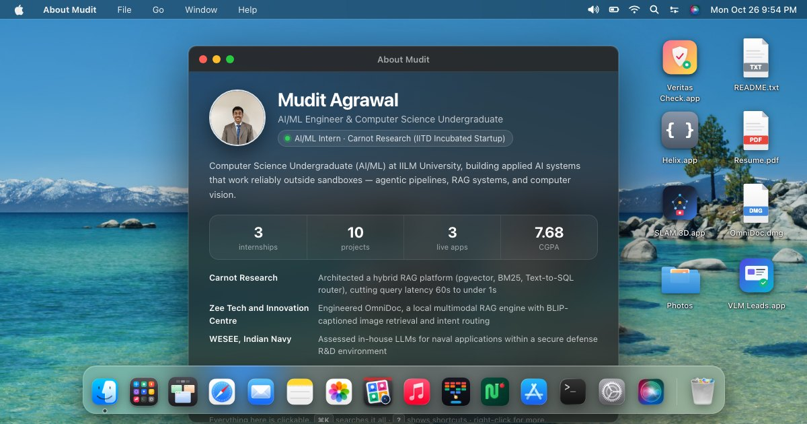

# 🍎 MacOS Portfolio

A fully interactive, MacOS-themed portfolio website built with vanilla HTML, CSS, and JavaScript. Experience a complete desktop environment in your browser, featuring draggable windows, a functional dock, terminal emulator, and authentic macOS design aesthetics.


## ✨ Make it yours

This repository is a template. Clone it, answer one questionnaire, and both versions are about you: your name in the menu bar and on the Lock Screen, your projects in the App Store and Launchpad, your experience in Finder and Terminal, your résumé in Preview, and an Iris that answers questions about *your* work.

```bash
git clone https://github.com/muditagrawal-alt/MacOS_Portfolio.git my-portfolio
cd my-portfolio
npm install    # tools for the test suites; the site itself has no dependencies
npm start      # the first run opens the questionnaire at http://localhost:8000/setup/
```

You can also click **Use this template** on GitHub and clone your copy. You'll need Node 22 or later.

| Step | What you give it |
| --- | --- |
| About you | Name, pronouns, photo, role, tagline, bio |
| Contact & links | Email, phone, LinkedIn, GitHub, and profiles on 14 more networks, from Hugging Face to Bluesky |
| Experience, Education | Roles with highlights; degree, schooling, courses |
| Projects | Name, description, live link, repository, tags. No icon? One is drawn for you |
| Skills, Résumé | Skill groups; your PDF and certificates |
| Notes & extras | Principles, notes, writing, ideas you dropped (all optional) |
| Site & services | Your site's address, a contact-form key, Iris's model endpoint (optional) |

A live preview shows the real site, iPhone or Mac, with your answers as you type. **Build my portfolio** then writes everything into the repository:

- `js/data/profile.js`: the info bank, everything about you in one file
- `assets/me/`: your photo, résumé, certificates, project icons and a link-preview card drawn for you
- the page titles, link-preview tags, Home Screen name and serverless settings, regenerated from the info bank

After that it offers to remove the previous owner's photos, certificates and icons, and shows you how to publish:

```bash
git add -A && git commit -m "Make the portfolio mine"
git push
```

On GitHub, go to **Settings → Pages → Deploy from a branch → `main` / (root)**. Your portfolio is at `https://<you>.github.io/<repository>/`, and phones get the iPhone version.

### Your admin

Once it's yours, `npm run admin` opens your admin: the same questionnaire, starting from what's live. Change a photo, the résumé, a project's demo video or links, certificates, hackathons; both the Mac and iPhone versions follow. **Save** keeps the changes on your computer, and **Publish** commits and pushes just those files, so the live site updates in about a minute with no git commands. It shows the branch and the files before anything goes out.

The admin is never public. It runs on your computer only (`127.0.0.1`; other machines and other websites are refused), and `setup/` is excluded from the deployed site (`_config.yml` for GitHub Pages, `.vercelignore` for Vercel).

You can also edit `js/data/profile.js` by hand and run `npm run refresh`. [setup/README.md](setup/README.md) describes every field, and the questionnaire can import and export the info bank as JSON.

**No Node?** Serve the folder with any static server on your computer (`python3 -m http.server`) and open `/setup/`: its **Download profile.js** button gives you the file to put in `js/data/profile.js`.

## 📱 One link, two experiences

The same URL opens the right portfolio for the device:

| Device | Opens | What it is |
| --- | --- | --- |
| Laptop / desktop | `index.html` | The macOS desktop: Finder, Terminal, Safari, Music, games, Iris |
| iPhone / Android phone | `ios.html` | An iPhone: Lock Screen, Home Screen with live widgets, and 12 apps |
| iPad / tablet | `ios.html` | The same apps in an iPad layout |

`js/router.js` runs first in both pages, before anything paints, and decides by how the device is *used*: touch-first phones and tablets (including iPadOS, which reports itself as a Mac) get the iPhone version, while a narrow desktop window or a touchscreen laptop stays on the Mac. Visitors can switch either way, and the choice is remembered:

- **Mac → iPhone:** Apple menu ▸ *View iPhone Version*. On a computer the phone is drawn as a framed device, with *Back to the Mac version* underneath.
- **iPhone → Mac:** Settings ▸ *View Mac Version*.
- **For a link:** `?view=ios` or `?view=mac` forces a version for that visit only, and is removed from the address bar.

Both versions read the same data (`js/data/*`), use the same services (`js/shared/*`), and run the same Iris engine (`js/apps/iris-brain.js`), so a change to a project or the résumé shows up in both.

### The iPhone version

- **Navigation that feels native:** every page is a History API entry (`#/app/path`), so the phone's own back swipe and Android's Back button work, deep links open the right page, and Back walks up the app. Apps zoom out of their icons; the home bar (tap or drag up) goes home.
- **Messages is Iris:** answers come from the portfolio, each with source chips that open the app the answer came from.
- **Apps:** About (contact card, experience, education, skills), Projects (App Store product pages), Résumé, Photos (certificates), Notes (shared with the Mac's Notes in the same browser, plus *Recently Deleted* post-mortems), Mail (sends to the owner's inbox), Safari (start page and portfolio search), Music (recordings, radio, and generative tracks synthesised in the browser), Weather, Calculator and Settings (light/dark, wallpaper, haptics).
- **Installable:** Add to Home Screen gives a full-screen app with its own icon.

## 📸 Screenshot

<div align="center">



*The template, set up by its author: the About window, live widgets and the desktop files*

</div>

## ✨ Features

### 🖥️ Complete Desktop Experience
- **MacOS Menu Bar** - Fully functional top menu bar with Apple menu, Finder, View, Go, Window, and Help menus
- **Desktop Icons** - Double-click to open folders (About, Experience, Education, Projects, Skills, Contact)
- **Draggable Windows** - Click and drag windows anywhere on the desktop
- **Window Controls** - macOS-style traffic lights (close, minimize, maximize)
- **Dock** - Animated dock at the bottom with app icons and tooltips
- **Live Clock** - Real-time clock display in the menu bar
- **Battery Status** - Live battery indicator with charge level and charging status
- **Wi-Fi Indicator** - Connection status display

### 📁 Interactive Windows
Each window features:
- Sidebar navigation for quick access to all sections
- Smooth animations and transitions
- Authentic macOS window styling
- Content-specific layouts (grid, list, card views)

### 💼 What visitors find

All of it is built from the info bank, so adding a project or a role shows up everywhere at once:

- **About**: who you are, what you're doing now, and stats computed from your data
- **Experience, education, skills**: Finder folders, the Résumé app, Terminal (`cat experience.txt`) and Iris
- **Projects**: App Store product pages with live links, Launchpad icons, Spotlight and Safari search
- **Contact**: Mail (to your inbox), a vCard over AirDrop, and your links in Finder and on the iPhone
- **Extras**: Notes, a reading list in Safari, certificates in Photos, and the ideas you dropped in the Trash

### 🖨️ Resume Viewer
- PDF preview with embedded image
- One-click download button
- Full-screen viewing capability

### 💻 Terminal Emulator
Interactive terminal with custom commands:
- Navigate the portfolio
- Display system information
- Execute custom commands
- Authentic terminal styling

## 🚀 Quick Start

```bash
npm start            # http://localhost:8000 (the questionnaire opens on the first run)
npm run setup        # reopen the questionnaire
npm run admin        # your admin: edit what's live, then Publish
npm run refresh      # after editing js/data/profile.js by hand
```

There's no build step. Any static server works for just viewing the site (`python3 -m http.server 8000`), but `npm start` is what lets the questionnaire save.

## 📂 Project Structure

See [Architecture](#architecture) below for a file-by-file map.

## 🎨 Customization

### Updating Content

Everything visitors read comes from the info bank, `js/data/profile.js`. Finder's files, Spotlight and Iris's search index, the desktop files, Notes, Photos and the Trash are all generated from it (`js/data/filesystem.js`, `corpus.js`, `desktop-files.js`, `notes.js`). One edit therefore updates every app on both versions. Use the questionnaire (`npm run setup`), or edit the file and run `npm run refresh`. [setup/README.md](setup/README.md) describes every field.

### Styling

- **Colours & motion tokens**: `css/variables.css` (the accent colour is `--accent`; System Settings can change it live)
- **Fonts**: the system font (San Francisco on Apple devices) is first in `--font-ui` in `css/base.css`; Inter is the fallback elsewhere

### Terminal Commands

Add a `case` to the `switch (cmd)` in `js/apps/terminal.js`, and list it in `TERMINAL_COMMANDS` for Tab completion.

## 🌐 Deployment

### GitHub Pages

1. Go to repository Settings
2. Navigate to Pages section
3. Choose **Deploy from a branch**, then `main` / (root)
4. Your site will be live at `https://yourusername.github.io/MacOS_Portfolio`. Pages caches pages for about ten minutes, so a new push can take that long to show

### Netlify / Vercel

1. Connect your GitHub repository
2. Deploy with default settings (no build command needed)
3. Custom domain supported

### Manual Hosting

Upload all files to any static hosting service (AWS S3, Firebase Hosting, etc.)

## 🔧 Technical Details

### Pure Vanilla Stack
- **No frameworks** - Built entirely with vanilla HTML, CSS, and JavaScript
- **No dependencies** - The site needs no npm, webpack or build step. Node runs only the setup questionnaire and the tests
- **No backend** - Fully static, client-side only (the optional Iris model proxy is a single serverless function)
- **Lightweight** - Fast load times, minimal resource usage

### Browser Compatibility
- ✅ Chrome/Edge (90+)
- ✅ Firefox (88+)
- ✅ Safari (14+)
- ✅ Mobile browsers (responsive design)

### Features Implementation
- **Drag & Drop**: Custom JavaScript drag handlers
- **Window Management**: Z-index stacking and position tracking
- **Battery API**: Navigator Battery Status API
- **Responsive**: CSS media queries for mobile adaptation
- **Animations**: CSS transitions and transforms

## 📱 Mobile Responsiveness

Phones and tablets get the iPhone version (above). If a visitor chooses the Mac version on a phone, or narrows a desktop window, `css/responsive.css` adapts it:
- Windows become full-width sheets between the menu bar and the Dock
- Finder, Settings, Music and App Store sidebars become swipeable pill strips
- Mail and Notes push from the list to the detail, with a Back button
- The Dock keeps the essential apps; everything else is one tap away in Launchpad

## 🤝 Contributing

Contributions are welcome! If you'd like to improve this project:

1. Fork the repository
2. Create a feature branch (`git checkout -b feature/AmazingFeature`)
3. Commit your changes (`git commit -m 'Add some AmazingFeature'`)
4. Push to the branch (`git push origin feature/AmazingFeature`)
5. Open a Pull Request

## 📄 License

This project is licensed under the MIT License - see the [LICENSE](LICENSE) file for details.

## 🙏 Acknowledgments

- Design inspired by macOS Big Sur/Monterey
- Icons from [Font Awesome](https://fontawesome.com/)
- Fonts from [Google Fonts](https://fonts.google.com/)

## 📧 Author

**Mudit Agrawal** made this template; the live demo is his portfolio.

- Email: muditagrawal03@gmail.com
- LinkedIn: [Mudit Agrawal](https://www.linkedin.com/in/mudit-agrawal-167610318)
- GitHub: [@muditagrawal-alt](https://github.com/muditagrawal-alt)
- HuggingFace: [muditagrawal03](https://huggingface.co/muditagrawal03)
- Substack: [standardissuemudit](https://substack.com/@standardissuemudit)
- Medium: [@muditagrawal03](https://medium.com/@muditagrawal03)
- X (Twitter): [@muditag52751860](https://x.com/muditag52751860)
- LeetCode: [muditagrawal03](https://leetcode.com/u/muditagrawal03/)

---

⭐ **Star this repository** if you found it helpful or interesting!

## Architecture

```
index.html              markup for the desktop, dock, menu bar and every app window
ios.html                the iPhone / iPad version
manifest.webmanifest    Add to Home Screen
css/
  variables.css         design tokens
  base.css              reset, desktop canvas, wallpaper
  menu-bar.css          menu bar + dynamic per-app menus
  dock.css              dock, magnification, running indicators
  window.css            window chrome, focus states, traffic lights
  context-menu.css      right-click menus + ⌥Tab switcher
  spotlight.css         ⌘K search panel
  quick-look.css        Space-bar preview overlay
  boot.css              startup animation
  system-ui.css         notification banners, brightness veil, window motion, Frosted Glass
  responsive.css        must load LAST — its media queries override the rest
  apps/*.css            one file per application
js/
  router.js             device router — loaded first by both pages
  data/profile.js       the info bank: everything about the owner, and nothing anywhere else
  data/profile-schema.js  defaults and derived fields (first name, pronouns, links) for every app
  data/corpus.js        ONE search index, shared by Safari, Spotlight and Iris (from the info bank)
  data/filesystem.js    Finder's folders and files (from the info bank)
  data/desktop-files.js desktop files, Photos certificates, Trash post-mortems (from the info bank)
  data/notes.js         Notes content (from the info bank)
  data/music.js         music catalogue + radio fallbacks
  shared/live-data.js   live weather and GitHub activity, cached
  shared/contact-form.js  the one contact-form send path, vCard + share helpers
  shared/generative-audio.js  Web Audio engine for Music's generative tracks
  ios/system.js         iPhone shell: navigation, Lock & Home Screens, widgets, Search
  ios/apps/*.js         one file per iPhone app (+ css/ios/apps/*.css)
  config/config.js      runtime config — contains no secrets
  core/utils.js         escapeHtml / safeUrl / openExternal, math parser
  core/window-manager.js  open, close, focus, drag, clamp, cascade, maximize
  core/keyboard.js      global shortcuts (⌘K, ⌥-window commands) + ⌥Tab app switcher
  core/spotlight.js     ⌘K search + quick actions
  core/context-menu.js  right-click menus per surface
  core/menu-bar.js      clock + per-application menu definitions
  core/boot-animation.js  startup sequence (skippable, honours reduced-motion)
  core/quick-look.js    Space-bar previews
  core/system-status.js Wi-Fi + battery indicators
  core/control-center.js  Control Centre (brightness veil, volume, Now Playing)
  core/desktop-widgets.js live clock, weather and GitHub widgets
  core/profile-bind.js  fills data-tpl="{name}"-style placeholders in the markup from the info bank
  core/setup-hint.js    "Make this portfolio yours", on a fresh clone's local server only
  apps/welcome.js       the About window, first thing a visitor sees
  apps/iris-brain.js    Iris's in-browser RAG: BM25 retrieval + cited answers
  apps/*.js             one controller per application
setup/
  index.html, setup.js  the questionnaire: every field, live preview, build
  apply.js              writes an info bank into the repository (`npm run refresh`)
  site-meta.js          the page titles and link-preview tags, generated from the info bank
  profile-format.js     reads and writes js/data/profile.js
  README.md             every field of the info bank
scripts/
  dev-server.js         `npm start`: local server + the questionnaire's save endpoints (localhost only)
  test-*.js             CI gates 1–5 (see Testing)
api/iris.js             serverless model proxy — keeps the API key server-side
api/_owner.js           who the serverless functions speak for (generated)
```

### Conventions

**Stylesheets are linked individually from `index.html`, never `@import`ed.**
`@import` forces a serial waterfall and previously caused four sheets to load
twice. `responsive.css` must stay last.

**Everything user-supplied is escaped before it reaches `innerHTML`.**
Use `escapeHtml()` for text, `escapeAttr()` inside inline handlers, and
`safeUrl()` / `openExternal()` for anything that becomes an `href`.

**There is one search corpus.** `window.PORTFOLIO_CORPUS` in
`js/data/corpus.js` backs Safari's "From this portfolio" results, Spotlight,
and Iris's offline answers. Add content there once, not in three places.

**No API keys in client code.** `js/config/config.js` is safe to commit.
Model access goes through `api/iris.js`; see `api/README.md`.

### Keyboard shortcuts

Every shortcut below reaches the page. Browsers and macOS reserve ⌘W, ⌘Q, ⌘N, ⌘T, ⌘M, ⌘Space and ⌘Tab
before a website ever sees them (⌘W would close your tab), so window commands use ⌥ instead. Press `?` on the desktop for this list.

| Shortcut | Action |
| --- | --- |
| `⌘K` | Spotlight — search everything |
| `⌥L` | Launchpad |
| `F3` | Mission Control |
| `⌥Tab` | Switch between running apps |
| `⌥W` | Close the frontmost window |
| `⌥M` | Minimise |
| `⌥N` | New Finder window / Note / Message (depending on the app) |
| `⌥T` | New Safari tab |
| `⌥,` | System Settings |
| `⌥1` `⌥2` `⌥3` | Finder: icons / list / columns |
| `⌘[` `⌘]` | Back / Forward in Finder and Safari |
| `⌘F` | Focus the frontmost app's search field |
| `⌘L` / `⌘R` | Safari: address bar / reload the page |
| `⌃L` | Clear the Terminal |
| `⌃⌥Q` | Lock Screen |
| `Space` | Quick Look the selection (arrow keys step through desktop files) |
| `↑` `↓` / `Tab` | Terminal history / completion |

## Testing

```bash
npm install                       # Node 22.22+ or 24.15+ (jsdom's requirement)
npx playwright install chromium   # once, for the browser suite
npm run test:all
```

| Gate | Command | What it checks |
| --- | --- | --- |
| 1 | `npm run test:syntax` | Every JS file parses |
| 2 | `npm run test:assets` | Every asset referenced from both pages, the manifest **and** JS exists |
| 3 | `npm run test:components` | Behaviour in jsdom, plus wiring integrity: every inline handler and menu command calls a real function, every linked Settings pane / Finder location exists |
| 4 | `npm run test:e2e` | Real Chromium: every Dock app, traffic lights, lock screen, Quick Look, Spotlight, Mail/Safari XSS, camera release, keyboard shortcuts, Iris grounding; device routing (iPhone, iPadOS, overrides); every iPhone app's main flow, Back/deep links, and no sideways scrolling on iPhone and iPad; and the whole clone experience, where a new person fills in the questionnaire in a fresh copy and no trace of the previous owner survives |
| 5 | `npm run test:template` | The template stays a template: nothing from the info bank (name, email, handles, project names, employers) appears anywhere else in the code, and the generated titles and link previews match it |

The E2E suite answers GitHub, weather, Wikipedia and radio requests from fixtures and intercepts the contact form, so it is deterministic and never sends real email. Its expectations come from the info bank, so it still passes once the portfolio is yours. `npm run test:e2e -- safari` runs only matching sections.
