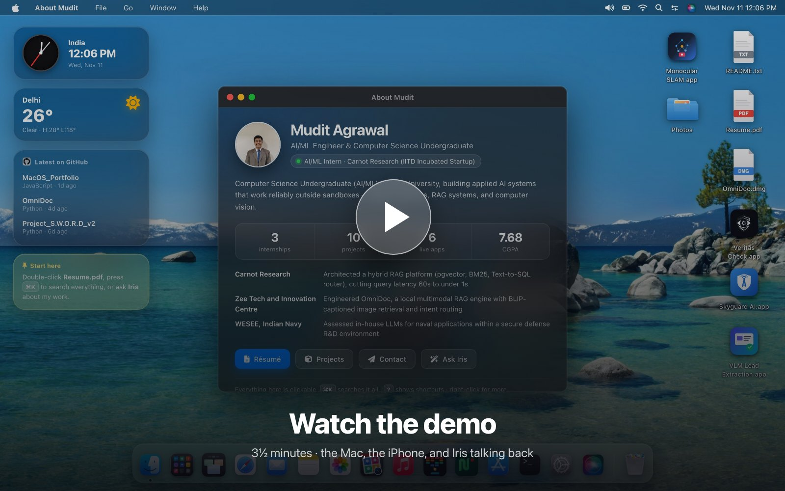
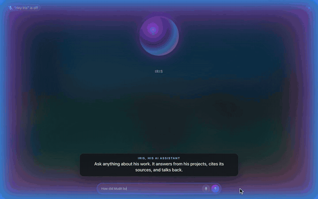
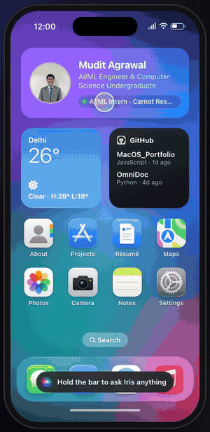
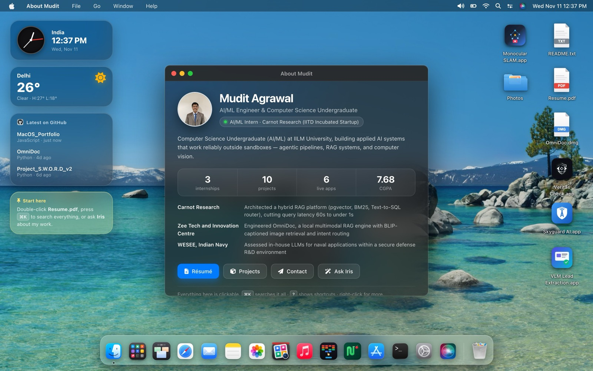
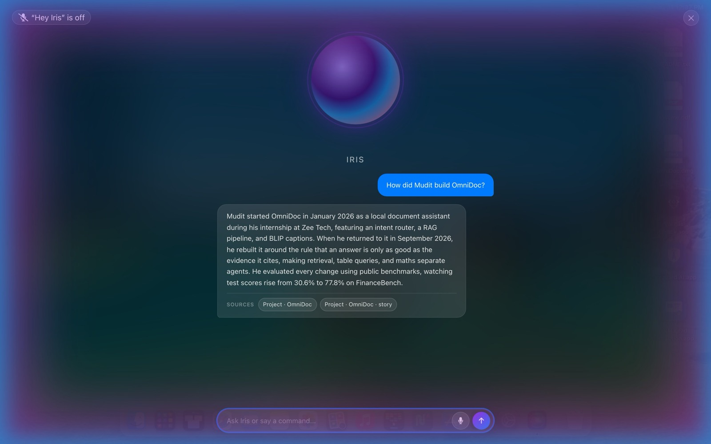
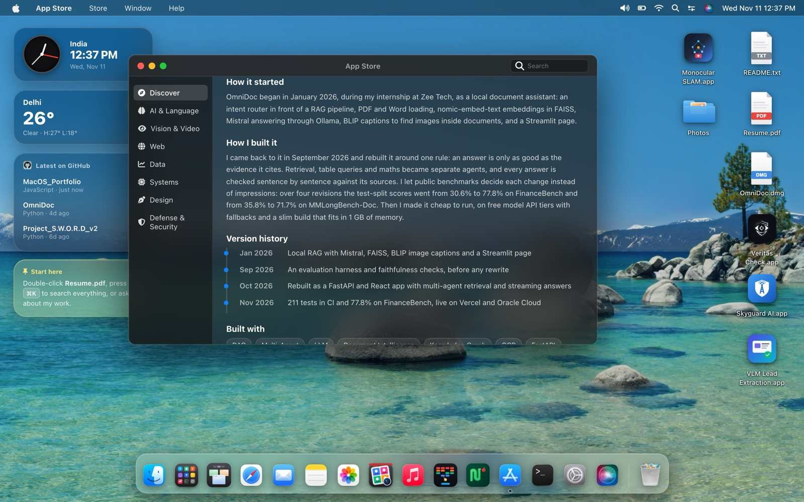
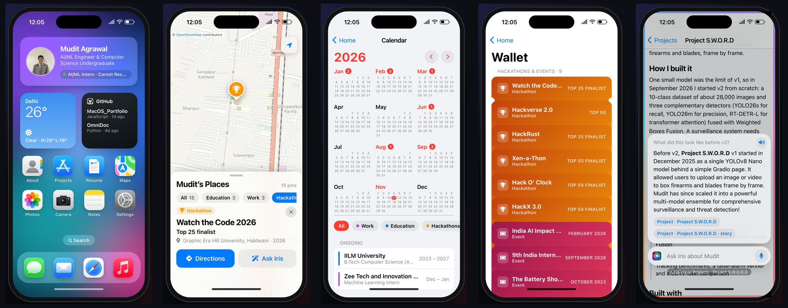

<div align="center">

# Mudit Agrawal

### A portfolio you use, not read

I build applied AI systems that hold up outside the sandbox: agentic RAG, document intelligence and computer vision.<br>
This repository is my portfolio. On a laptop it is a working macOS desktop. On a phone it is an iPhone.<br>
On both, **Iris**, an AI assistant that knows my work, answers your questions and talks back.

**[Open the live portfolio →](https://macos-portfolio-mauve-seven.vercel.app)** &nbsp;·&nbsp; [Watch the demo](#-the-demo) &nbsp;·&nbsp; [LinkedIn](https://www.linkedin.com/in/mudit-agrawal-167610318) &nbsp;·&nbsp; [Email](mailto:muditagrawal03@gmail.com) &nbsp;·&nbsp; [GitHub](https://github.com/muditagrawal-alt)

[](https://macos-portfolio-mauve-seven.vercel.app)
[](https://github.com/muditagrawal-alt/MacOS_Portfolio/actions/workflows/ci.yml)
[](#testing)
[](#-how-its-built)
[](#iris)
[](LICENSE)

</div>

## ▶ The demo

<a href="https://macos-portfolio-mauve-seven.vercel.app/docs/media/portfolio-demo.mp4"></a>

<sub>A captioned walkthrough of the live site, Mac then iPhone, with Iris speaking ([MP4 in this repository](docs/media/portfolio-demo.mp4)). Music: “Wallpaper” by Kevin MacLeod (incompetech.com), licensed under CC BY 4.0.</sub>

<table>
<tr>
<td width="62%" align="center"><br><sub><b>On a laptop:</b> a Mac that boots, with Iris answering out loud</sub></td>
<td width="38%" align="center"><br><sub><b>On a phone:</b> an iPhone, with Iris a long press away</sub></td>
</tr>
</table>

## 👋 About me

I'm Mudit, a Computer Science (AI/ML) undergraduate at IILM University (2023–2027) and an AI/ML intern at Carnot Research, an IIT Delhi-incubated startup. I'm looking for roles in **applied ML, LLM systems and computer vision**.

- **Carnot Research** · AI/ML Intern · June 2026 – now: architected a hybrid RAG platform (pgvector, BM25, a Text-to-SQL router) that cut query latency from 60 s to under 1 s, and three Intel-optimised INT8 RAG modes that are 2–3× faster at 92% Recall@10.
- **Zee Tech and Innovation Centre** · ML Intern · Dec 2025 – Jan 2026: built the first OmniDoc, a local multimodal RAG engine with BLIP-captioned image retrieval.
- **WESEE, Indian Navy** · Summer Intern · June – July 2025: evaluated in-house LLMs and validated RAG pipelines for naval applications.
- **Hackathons:** six finals, including Top 25 at Watch the Code 2026 and at HackRust.
- **Certificates:** NPTEL Elite + Silver (IIIT Hyderabad) and Elite (IIT Madras), AWS Academy Machine Learning Foundations, and [the rest on LinkedIn](https://www.linkedin.com/in/mudit-agrawal-167610318/details/certifications/).

## 🛠 What I've shipped

| Project | What it does | Proof |
| --- | --- | --- |
| **OmniDoc** · [live](https://omnidoc-silk.vercel.app) · [code](https://github.com/muditagrawal-alt/OmniDoc) | Ask PDFs, scans and spreadsheets anything; every claim cites its page, every sentence is checked | 77.8% on FinanceBench and 71.7% on MMLongBench-Doc; 211 tests in CI |
| **Veritas Check** · [live](https://veritas-check.vercel.app) · [code](https://github.com/muditagrawal-alt/Deepfake-and-Fake-News-Detector) | Is this news story, image or video what it claims to be? | 0.804 accuracy on FakeNewsNet-PolitiFact |
| **SkyGuard AI** · [live](https://skyguard-ai-orcin.vercel.app) · [code](https://github.com/muditagrawal-alt/Skyguard_AI_SIH2026) | Tells a faulty weather-station sensor from real weather, and repairs the readings (Smart India Hackathon 2026) | 95.1% F1 and no false alarms on storms, on its benchmark |
| **VLM Lead Extraction** · [live](https://muditagrawal-lead-extraction.vercel.app) · [code](https://github.com/muditagrawal-alt/VLM_Business_Card_Lead_Extraction) | Business cards in, a verified lead list out | 100% field accuracy on hard test cards; 95–97% on real cards |
| **Monocular SLAM** · [live](https://muditagrawal-alt--monocular-slam.modal.run) · [code](https://github.com/muditagrawal-alt/Monocular_RGB_Sparse_Point_Cloud_SLAM) | A camera path and a 3D point cloud from one ordinary video, no GPU | A 10-second clip in 5.5–6.7 s on 4 CPU cores |
| **S.W.O.R.D v2** · [code](https://github.com/muditagrawal-alt/Project_S.W.O.R.D_v2) | Multi-model weapon detection for surveillance (in development) | Three detectors fused with WBF, ~28,000 images |
| **Multiva.Ai** · [code](https://github.com/muditagrawal-alt/Multiva.Ai) | Dubs a talking-head video into 12 Indian languages in the speaker's own voice, fully offline | A 46-second clip dubbed in 8 minutes on a laptop |
| **Sliver.Ai** · [code](https://github.com/muditagrawal-alt/Sliver-Smart-Video-Clipping-Tool) | On-device highlight reels that keep each moment's context | YOLO11m, YOLOv8-Face and CLIP prompts, nothing uploaded |
| **Helix Compiler** · [live](https://huggingface.co/spaces/muditagrawal03/Helix-Compiler) · [code](https://github.com/muditagrawal-alt/Helix-Compiler) | A small compiler in C, with every phase visible | Lexer to DAG optimiser |
| **Artifex.ai** · [code](https://github.com/muditagrawal-alt/Artifex.ai) | Text-to-image with Stable Diffusion | Modular Gradio app |

Every project has a page in the portfolio with its demo video and the story of how it was built, from the first version to now. Ask Iris “how did he build OmniDoc?”

## ✨ What's inside

<table>
<tr>
<td width="50%"></td>
<td width="50%"></td>
</tr>
<tr>
<td></td>
<td></td>
</tr>
</table>

**On a laptop, a Mac.** It boots, shows a lock screen, and opens on a desktop with a live clock, local weather and my latest GitHub pushes. Finder holds my experience, education and skills as files. The App Store has a page for every project: live app, code, demo video, and how it was built. Spotlight (⌘K) finds anything, even maths. Terminal knows `neofetch`, `projects` and `sudo hire-me`. Photos has my certificates and badges. Mail, Notes, Music, Safari, Preview (my résumé), Mission Control, Launchpad, Control Centre with dark mode, and Snake and Breakout complete it.

**On a phone, an iPhone.** A lock screen where Iris says hello, a Home Screen with live widgets, and every deployed project as an app that opens inside the phone. Maps pins my university, schools, internships, hackathons and events. Calendar shows my career by year, and Wallet shows certificates as passes and hackathons as tickets. Plus Projects, Photos, Camera, Messages, Mail, Safari, Music, Weather, Settings, 2048 and Snake.

<a id="iris"></a>**Iris, everywhere.** Ask anything about my work, however it's phrased. Iris answers from the portfolio's own content, cites its sources, opens things when asked (“open his résumé”, “show me where he competed”), and answers out loud when you ask out loud. On the iPhone, hold the home bar in any app and it knows what you're looking at. Ask how a project was built or what it looked like at first, and it tells the story in my own words.

## 🧱 How it's built

- **No framework, no build step.** About 36,000 lines of vanilla HTML, CSS and JavaScript. The site has no dependencies; Node only runs the setup tools and the tests.
- **One source of truth.** Everything about me lives in one info bank, `js/data/profile.js`. Every app on both versions reads it: Finder, the App Store, Maps, Calendar, Wallet, Spotlight and Iris. One edit updates all of them.
- **Iris is retrieval first.** An in-browser BM25 index over the info bank finds the relevant passages and cites them. A serverless proxy, `api/iris.js`, sends the question with those passages to Gemini, or to Groq if it's set. The key stays server-side, the prompt is owned by the server, and requests have origin checks and rate limits. With no model, or when the free tier is busy, the in-browser engine answers on its own.
- **One link, the right device.** `js/router.js` runs before anything paints and sends touch-first devices to the iPhone version, computers to the Mac.
- **Tested like a product.** Five CI gates on every push to `main`: syntax, asset integrity, a jsdom behaviour suite, 291 real-browser Playwright tests across the Mac, iPhone and iPad, and a template gate that keeps anything personal out of the code.
- **Shipped.** Deployed on Vercel with cookieless analytics. A GitHub Pages copy forwards its visitors to the live address, and Reduce Motion is respected throughout.

## 📈 How it evolved

| | April 2026, the first version | November 2026 |
| --- | --- | --- |
| What it was | A macOS-themed page: a few windows, a terminal and a résumé viewer | A Mac on laptops, an iPhone on phones, and an AI assistant on both |
| Code | 5 files, about 1,700 lines | About 150 files and 36,000 lines, plus 3,000 lines of tests and tooling |
| Content | Written into the HTML | One info bank drives both versions, edited through a private admin |
| Assistant | None | Iris: in-browser RAG with citations, Gemini through a serverless proxy, voice, actions |
| Quality | Checked by hand | Five CI gates and 291 browser tests on every push |
| Hosting | GitHub Pages | Vercel, with the Pages copy forwarding to it |

Along the way: a modular rewrite into one controller per app, the iPhone version with a device router, Iris from keyword matching to retrieval with sources and then a hosted model, the questionnaire that turns the repository into a template, a private admin, and project pages that tell each project's story.

## 🧰 Make it yours

This repository is also a template. Clone it, answer one questionnaire, and both versions are about you: your name in the menu bar and on the Lock Screen, your projects in the App Store and Launchpad, your experience in Finder and Terminal, your résumé in Preview, and an Iris that answers questions about *your* work.

```bash
git clone https://github.com/muditagrawal-alt/MacOS_Portfolio.git my-portfolio
cd my-portfolio
npm install    # tools for the test suites; the site itself has no dependencies
npm start      # the first run opens the questionnaire at http://localhost:8000/setup/
```

You'll need Node 22 or later. The questionnaire asks for:

| Step | What you give it |
| --- | --- |
| About you | Name, pronouns, photo, role, tagline, bio |
| Contact & links | Email, phone, LinkedIn, GitHub, and profiles on 14 more networks, from Hugging Face to Bluesky |
| Experience, Education | Roles with highlights; degree, schooling, courses |
| Projects | Name, description, live link, repository, tags, demo video, how it started and how you built it |
| Hackathons & events | Where and when, with places pinned for Maps |
| Skills, Résumé | Skill groups; your PDF, certificates and badges |
| Notes & extras | Principles, notes, writing, ideas you dropped (all optional) |
| Site & services | Your site's address, a contact-form key, Iris's model endpoint, analytics (optional) |

A live preview shows the real site, iPhone or Mac, with your answers as you type. **Build my portfolio** then writes everything into the repository:

- `js/data/profile.js`: the info bank, everything about you in one file
- `assets/me/`: your photo, résumé, certificates, project icons and a link-preview card drawn for you
- the page titles, link-preview tags, Home Screen name and serverless settings, regenerated from the info bank

After that it offers to remove the previous owner's photos, certificates and icons. Commit and push, then deploy (see [Deployment](#deployment)).

### Your admin

Once it's yours, `npm run admin` opens your admin: the same questionnaire, starting from what's live. Change a photo, the résumé, a project's demo video or story, certificates, hackathons; both the Mac and iPhone versions follow. **Save** keeps the changes on your computer, and **Publish** commits and pushes just those files, so the live site updates in about a minute with no git commands. It shows the branch and the files before anything goes out.

The admin is never public. It runs on your computer only (`127.0.0.1`; other machines and other websites are refused), and `setup/` is excluded from the deployed site (`_config.yml` for GitHub Pages, `.vercelignore` for Vercel). [setup/README.md](setup/README.md) describes every field; you can also edit `js/data/profile.js` by hand and run `npm run refresh`.

## 📱 One link, two experiences

| Device | Opens | What it is |
| --- | --- | --- |
| Laptop / desktop | `index.html` | The macOS desktop |
| iPhone / Android phone | `ios.html` | An iPhone: Lock Screen, Home Screen with live widgets, and its apps |
| iPad / tablet | `ios.html` | The same apps in an iPad layout |

`js/router.js` decides by how the device is *used*: touch-first phones and tablets (including iPadOS, which reports itself as a Mac) get the iPhone version, while a narrow desktop window or a touchscreen laptop stays on the Mac. Visitors can switch either way and the choice is remembered: Apple menu ▸ *View iPhone Version* on the Mac (the phone is drawn as a framed device), Settings ▸ *View Mac Version* on the iPhone, or `?view=ios` / `?view=mac` for a single visit.

On the iPhone, every page is a History API entry (`#/app/path`), so the phone's own back swipe and Android's Back button work and deep links open the right page. On Android the unlock swipe hides the browser's bars; installed to the Home Screen it opens full screen on any phone.

## Architecture

```
index.html              markup for the desktop, dock, menu bar and every app window
ios.html                the iPhone / iPad version
manifest.webmanifest    Add to Home Screen
css/
  variables.css         design tokens
  window.css            window chrome, focus states, traffic lights
  system-ui.css         notification banners, brightness veil, window motion
  responsive.css        must load LAST — its media queries override the rest
  apps/*.css, ios/      one file per application
js/
  router.js             device router — loaded first by both pages
  data/profile.js       the info bank: everything about the owner, and nothing anywhere else
  data/profile-schema.js  defaults and derived fields for every app
  data/corpus.js        ONE search index, shared by Safari, Spotlight and Iris
  data/filesystem.js    Finder's folders and files, and the App Store's projects
  data/desktop-files.js desktop files, Photos (certificates and badges), Trash
  shared/iris-client.js the one way to ask Iris: the hosted model, or the in-browser engine
  shared/iris-voice.js  Iris's voice, for the Mac and the iPhone
  shared/analytics.js   cookieless Vercel Web Analytics, on the deployed site only
  ios/system.js         iPhone shell: navigation, Lock & Home Screens, widgets, Search
  ios/apps/*.js         one file per iPhone app, incl. live-apps.js (projects as apps)
  ios/iris-everywhere.js  hold the home bar: Iris over any app, aware of the screen
  core/*.js             window manager, keyboard, Spotlight, menus, boot, Control Centre…
  apps/iris-brain.js    Iris's in-browser RAG: BM25 retrieval + cited answers
  apps/*.js             one controller per Mac application
setup/                  the questionnaire and admin (local only, never deployed)
scripts/                dev server and the five CI gates
api/iris.js             serverless model proxy: Groq or Gemini, key server-side; see api/README.md
```

### Conventions

- **Stylesheets are linked individually, never `@import`ed**, and `responsive.css` stays last.
- **Everything user-supplied is escaped** before it reaches `innerHTML`: `escapeHtml()` for text, `escapeAttr()` inside inline handlers, `safeUrl()` / `openExternal()` for anything that becomes an `href`.
- **There is one search corpus.** `js/data/corpus.js` backs Safari, Spotlight and Iris. Add content once.
- **No API keys in client code.** `js/config/config.js` is safe to commit; model access goes through `api/iris.js`.

### Keyboard shortcuts

Browsers and macOS reserve ⌘W, ⌘Q, ⌘N, ⌘T, ⌘M, ⌘Space and ⌘Tab before a website sees them, so window commands use ⌥. Press `?` on the desktop for the full list.

| Shortcut | Action |
| --- | --- |
| `⌘K` | Spotlight — search everything |
| `⌥L` / `F3` | Launchpad / Mission Control |
| `⌥Tab` | Switch between running apps |
| `⌥W` / `⌥M` | Close / minimise the frontmost window |
| `⌥,` | System Settings |
| `⌃⌥Q` | Lock Screen |
| `Space` | Quick Look the selection |

## Testing

```bash
npm install                       # Node 22.22+ or 24.15+ (jsdom's requirement)
npx playwright install chromium   # once, for the browser suite
npm run test:all
```

| Gate | Command | What it checks |
| --- | --- | --- |
| 1 | `npm run test:syntax` | Every JS file parses |
| 2 | `npm run test:assets` | Every asset referenced from both pages, the manifest, JS and the info bank exists |
| 3 | `npm run test:components` | Behaviour in jsdom, wiring integrity, Iris's answers and the model proxy's guardrails |
| 4 | `npm run test:e2e` | Real Chromium: every Mac app, device routing, every iPhone app's main flow, Iris, and the whole clone experience |
| 5 | `npm run test:template` | Nothing from the info bank appears anywhere else in the code, and generated files match it |

The browser suite answers GitHub, weather, Wikipedia and radio requests from fixtures and intercepts the contact form, so it is deterministic and never sends real email. `npm run test:e2e -- safari` runs only matching sections.

## Deployment

**Vercel** (the site and Iris's model together): import the repository at [vercel.com](https://vercel.com) with the framework set to **Other** (nothing to build), or run `vercel link` then `vercel deploy --prod`. Add `GEMINI_API_KEY` (or `GROQ_API_KEY`) under **Settings → Environment Variables** and redeploy; see [api/README.md](api/README.md). Each push to `main` deploys again. `.vercelignore` keeps the questionnaire, the admin, the tooling and `.env` off the deployment.

**GitHub Pages** works too (**Settings → Pages → Deploy from a branch → `main` / (root)**), without Iris's hosted model. If the site's address points elsewhere, the Pages copy forwards its visitors there.

## Credits

- Demo music: “Wallpaper” by Kevin MacLeod ([incompetech.com](https://incompetech.com)), licensed under [CC BY 4.0](https://creativecommons.org/licenses/by/4.0/)
- Icons: [Font Awesome](https://fontawesome.com/); map tiles: © OpenStreetMap contributors
- Design inspired by macOS and iOS; not affiliated with Apple

## License

MIT, see [LICENSE](LICENSE).

---

<div align="center">

**[Open the live portfolio →](https://macos-portfolio-mauve-seven.vercel.app)** &nbsp;·&nbsp; [LinkedIn](https://www.linkedin.com/in/mudit-agrawal-167610318) &nbsp;·&nbsp; [muditagrawal03@gmail.com](mailto:muditagrawal03@gmail.com)

</div>
